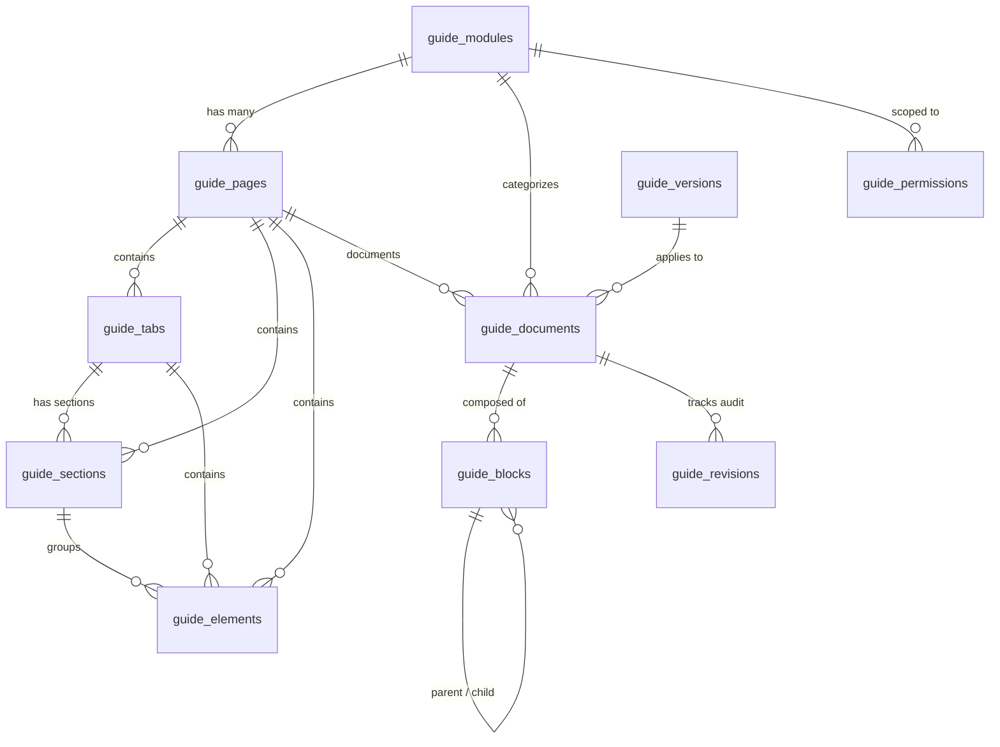

# System Guide API Documentation

Base URL: `/api/system-guide`

The **System Guide API** provides an enterprise documentation, user manual, and in-app onboarding engine for the ERP system. It manages hierarchical UI navigation structures (Modules &rarr; Pages &rarr; Tabs &rarr; Sections &rarr; Elements), rich documentation content blocks, revisions and snapshots, media assets, documentation versioning, and granular role/user access permissions.

---

## Table of Contents

- [Overview & Architecture](#overview--architecture)
- [Entity Relationship Diagram](#entity-relationship-diagram)
- [Authentication and Headers](#authentication-and-headers)
- [Standard Response Formats & Error Codes](#standard-response-formats--error-codes)
- [1. Guide Modules API](#1-guide-modules-api)
  - [1.1 List Modules](#11-list-modules)
  - [1.2 Get Module by ID](#12-get-module-by-id)
  - [1.3 Create Module](#13-create-module)
  - [1.4 Update Module](#14-update-module)
  - [1.5 Delete Module](#15-delete-module)
- [2. Guide Pages API](#2-guide-pages-api)
  - [2.1 List Pages by Module](#21-list-pages-by-module)
  - [2.2 Get Page by ID](#22-get-page-by-id)
  - [2.3 Create Page](#23-create-page)
  - [2.4 Update Page](#24-update-page)
  - [2.5 Delete Page](#25-delete-page)
- [3. Guide Tabs API](#3-guide-tabs-api)
  - [3.1 List Tabs by Page](#31-list-tabs-by-page)
  - [3.2 Get Tab by ID](#32-get-tab-by-id)
  - [3.3 Create Tab](#33-create-tab)
  - [3.4 Update Tab](#34-update-tab)
  - [3.5 Delete Tab](#35-delete-tab)
- [4. Guide Sections API](#4-guide-sections-api)
  - [4.1 List Sections by Page](#41-list-sections-by-page)
  - [4.2 List Sections by Tab](#42-list-sections-by-tab)
  - [4.3 Get Section by ID](#43-get-section-by-id)
  - [4.4 Create Section](#44-create-section)
  - [4.5 Update Section](#45-update-section)
  - [4.6 Delete Section](#46-delete-section)
- [5. Guide Elements API](#5-guide-elements-api)
  - [5.1 List Elements by Page](#51-list-elements-by-page)
  - [5.2 Get Element by ID](#52-get-element-by-id)
  - [5.3 Create Element](#53-create-element)
  - [5.4 Update Element](#54-update-element)
  - [5.5 Delete Element](#55-delete-element)
- [6. Guide Versions API](#6-guide-versions-api)
  - [6.1 List Versions](#61-list-versions)
  - [6.2 Get Version by ID](#62-get-version-by-id)
  - [6.3 Create Version](#63-create-version)
  - [6.4 Update Version](#64-update-version)
  - [6.5 Delete Version](#65-delete-version)
- [7. Guide Documents API](#7-guide-documents-api)
  - [7.1 List Documents](#71-list-documents)
  - [7.2 Get Complete Document by Path](#72-get-complete-document-by-path)
  - [7.3 Get Document by ID](#73-get-document-by-id)
  - [7.4 Create Document](#74-create-document)
  - [7.5 Update Document](#75-update-document)
  - [7.6 Publish Document](#76-publish-document)
  - [7.7 Unpublish Document](#77-unpublish-document)
  - [7.8 Delete Document](#78-delete-document)
- [8. Guide Blocks API](#8-guide-blocks-api)
  - [8.1 List Blocks by Document](#81-list-blocks-by-document)
  - [8.2 Create Block](#82-create-block)
  - [8.3 Reorder Blocks](#83-reorder-blocks)
  - [8.4 Get Block by ID](#84-get-block-by-id)
  - [8.5 Update Block](#85-update-block)
  - [8.6 Delete Block](#86-delete-block)
- [9. Guide Media API](#9-guide-media-api)
  - [9.1 List Media Assets](#91-list-media-assets)
  - [9.2 Get Media Asset by ID](#92-get-media-asset-by-id)
  - [9.3 Create Media Asset](#93-create-media-asset)
  - [9.4 Delete Media Asset](#94-delete-media-asset)
- [10. Guide Revisions API](#10-guide-revisions-api)
  - [10.1 List Revisions by Document](#101-list-revisions-by-document)
  - [10.2 Create Revision Snapshot](#102-create-revision-snapshot)
- [11. Guide Permissions API](#11-guide-permissions-api)
  - [11.1 List Permissions](#111-list-permissions)
  - [11.2 Upsert Permission](#112-upsert-permission)
  - [11.3 Delete Permission](#113-delete-permission)
- [12. Database Schema & Data Dictionary](#12-database-schema--data-dictionary)
- [13. Integration & Implementation Notes](#13-integration--implementation-notes)

---

## Overview & Architecture

The System Guide module serves two primary use cases:
1. **System Structural Map**: Mirrors the ERP navigation hierarchy from top-level application modules down to granular UI elements (buttons, inputs, tables, action triggers) so that help tips and tutorials can be anchored directly to ERP views.
2. **Interactive Manuals & Documentation**: Documents articles structured into modular blocks (text, markdown, step-by-step guides, callouts, images, code snippets, linked UI element references), versioned against ERP software releases with automatic revision history tracking.

```
+-----------------------------------------------------------------------------------+
|                                 Guide Modules                                     |
|                                       |                                           |
|                                       v                                           |
|                                  Guide Pages                                      |
|                             /          |          \                               |
|                            v           v           v                              |
|                       Guide Tabs  Guide Sections  Guide Elements                  |
|                            \           /                                          |
|                             v         v                                           |
|                      Nested Guide Sections / Elements                             |
+-----------------------------------------------------------------------------------+
                                        |
                                        v
+-----------------------------------------------------------------------------------+
|                                Guide Documents                                    |
|             (Linked to Module, Page, Tab, Section, & Version)                     |
|                                       |                                           |
|                  +--------------------+--------------------+                      |
|                  |                                         |                      |
|                  v                                         v                      |
|             Guide Blocks                            Guide Revisions               |
|    (Text, Steps, UI Element Refs,            (Full Point-in-Time Snapshot         |
|         Media, Callouts)                          of Doc & Blocks)                |
+-----------------------------------------------------------------------------------+
```

---

## Entity Relationship Diagram



---

## Authentication and Headers

All endpoints interact with the database using authenticated context. The user identity is extracted from JWT tokens or fallback headers.

| Header | Type | Description |
|---|---|---|
| `Authorization` | String | `Bearer <JWT_TOKEN>` with user payload (`id` / `user_id`, `username`, `access`). |
| `x-user-id` | Integer / String | *(Fallback for development/testing)* User ID used when populating audit fields (`created_by`, `updated_by`, `published_by`). |
| `Content-Type` | String | `application/json` for all request bodies. |

---

## Standard Response Formats & Error Codes

### Standard Success Response

```json
{
  "success": true,
  "data": {}
}
```
*When returning lists, `data` is an array of objects `[]`.*

### Standard Error Response

```json
{
  "success": false,
  "message": "Error description message"
}
```

### Common HTTP Status Codes

| Status Code | Description |
|---|---|
| `200 OK` | The request succeeded and data is returned. |
| `201 Created` | A new entity (document, module, block, revision, etc.) was successfully created. |
| `400 Bad Request` | Missing required parameters, invalid data types, or invalid request payload. |
| `401 Unauthorized` | Missing authentication token or invalid credentials. |
| `403 Forbidden` | The user lacks permissions to view, create, edit, or publish this resource. |
| `404 Not Found` | The requested entity does not exist in the database. |
| `409 Conflict` | Unique constraint violation (e.g. duplicate slug or unique key). |
| `500 Internal Server Error` | Database error, query execution failure, or unexpected application exception. |

---

## 1. Guide Modules API

Base Sub-Route: `/api/system-guide/modules`

Represents top-level functional modules within the ERP (e.g., Inventory, Recruitment, File Manager, Sales, Payroll).

### 1.1 List Modules

- **Method:** `GET`
- **Route:** `/api/system-guide/modules`
- **Description:** Retrieves all guide modules, ordered by `sort_order` ascending and `title` ascending. Can optionally filter to active modules only.

#### Query Parameters

| Parameter | Type | Required | Default | Description |
|---|---|---|---|---|
| `activeOnly` | Boolean | No | `false` | If `true`, returns only modules where `is_active = TRUE`. |

#### Response (`200 OK`)

```json
{
  "success": true,
  "data": [
    {
      "id": 1,
      "module_key": "file_manager",
      "title": "File Manager",
      "slug": "file-manager",
      "icon": "FolderOpenOutlined",
      "route": "/file-manager",
      "description": "NAS Storage, Personal Folders, Google Drive shortcuts and file sharing.",
      "sort_order": 1,
      "is_active": true,
      "auto_generated": false,
      "created_by": 3,
      "updated_by": 3,
      "created_at": "2026-09-10T08:30:00.000Z",
      "updated_at": "2026-09-10T08:30:00.000Z"
    }
  ]
}
```

---

### 1.2 Get Module by ID

- **Method:** `GET`
- **Route:** `/api/system-guide/modules/:id`
- **Description:** Retrieves a single module by its unique primary key `id`.

#### Path Parameters

| Parameter | Type | Required | Description |
|---|---|---|---|
| `id` | Integer | Yes | Unique ID of the module. |

#### Response (`200 OK`)

```json
{
  "success": true,
  "data": {
    "id": 1,
    "module_key": "file_manager",
    "title": "File Manager",
    "slug": "file-manager",
    "icon": "FolderOpenOutlined",
    "route": "/file-manager",
    "description": "NAS Storage, Personal Folders, Google Drive shortcuts and file sharing.",
    "sort_order": 1,
    "is_active": true,
    "auto_generated": false,
    "created_by": 3,
    "updated_by": 3,
    "created_at": "2026-09-10T08:30:00.000Z",
    "updated_at": "2026-09-10T08:30:00.000Z"
  }
}
```

#### Error Response (`404 Not Found`)

```json
{
  "success": false,
  "message": "Not found"
}
```

---

### 1.3 Create Module

- **Method:** `POST`
- **Route:** `/api/system-guide/modules`
- **Description:** Creates a new top-level guide module.

#### Request Body (`application/json`)

| Field | Type | Required | Default | Description |
|---|---|---|---|---|
| `module_key` | String | Yes | - | Unique programmatic key (e.g. `"file_manager"`, `"payroll"`). |
| `title` | String | Yes | - | Human-readable title of the module. |
| `slug` | String | Yes | - | URL-friendly unique identifier (e.g. `"file-manager"`). |
| `icon` | String | No | `null` | Icon name, class or SVG identifier. |
| `route` | String | No | `null` | Frontend router navigation path. |
| `description` | String | No | `null` | Detailed description of the module. |
| `sort_order` | Integer | No | `0` | Display priority order. |
| `is_active` | Boolean | No | `true` | Whether the module is active and visible. |
| `auto_generated`| Boolean | No | `false` | True if generated automatically by route scanner. |

```json
{
  "module_key": "recruitment",
  "title": "Recruitment & Onboarding",
  "slug": "recruitment",
  "icon": "UsergroupAddOutlined",
  "route": "/recruitment",
  "description": "Manage job positions, candidates, interview schedules, and applicant stages.",
  "sort_order": 2,
  "is_active": true,
  "auto_generated": false
}
```

#### Response (`201 Created`)

```json
{
  "success": true,
  "data": {
    "id": 2,
    "module_key": "recruitment",
    "title": "Recruitment & Onboarding",
    "slug": "recruitment",
    "icon": "UsergroupAddOutlined",
    "route": "/recruitment",
    "description": "Manage job positions, candidates, interview schedules, and applicant stages.",
    "sort_order": 2,
    "is_active": true,
    "auto_generated": false,
    "created_by": 5,
    "updated_by": 5,
    "created_at": "2026-09-19T12:00:00.000Z",
    "updated_at": "2026-09-19T12:00:00.000Z"
  }
}
```

---

### 1.4 Update Module

- **Method:** `PUT`
- **Route:** `/api/system-guide/modules/:id`
- **Description:** Updates fields for an existing module. Omitted fields retain their existing values in the database.

#### Path Parameters

| Parameter | Type | Required | Description |
|---|---|---|---|
| `id` | Integer | Yes | Unique ID of the module to update. |

#### Request Body (`application/json`)

All fields are optional:

```json
{
  "title": "Recruitment & Talent Acquisition",
  "sort_order": 3,
  "is_active": true
}
```

#### Response (`200 OK`)

```json
{
  "success": true,
  "data": {
    "id": 2,
    "module_key": "recruitment",
    "title": "Recruitment & Talent Acquisition",
    "slug": "recruitment",
    "icon": "UsergroupAddOutlined",
    "route": "/recruitment",
    "description": "Manage job positions, candidates, interview schedules, and applicant stages.",
    "sort_order": 3,
    "is_active": true,
    "auto_generated": false,
    "created_by": 5,
    "updated_by": 5,
    "created_at": "2026-09-19T12:00:00.000Z",
    "updated_at": "2026-09-19T12:15:00.000Z"
  }
}
```

---

### 1.5 Delete Module

- **Method:** `DELETE`
- **Route:** `/api/system-guide/modules/:id`
- **Description:** Deletes a module by its primary key ID.

#### Response (`200 OK`)

```json
{
  "success": true,
  "message": "Deleted successfully"
}
```

#### Error Response (`404 Not Found`)

```json
{
  "success": false,
  "message": "Not found"
}
```

---

## 2. Guide Pages API

Base Sub-Route: `/api/system-guide/pages`

Represents individual application screens, pages, or views belonging to a module (e.g. "Candidate List", "Candidate Details", "Recycle Bin").

### 2.1 List Pages by Module

- **Method:** `GET`
- **Route:** `/api/system-guide/pages/module/:moduleId`
- **Description:** Retrieves all pages mapped under a specific module ID, ordered by `sort_order` and `title`.

#### Path Parameters

| Parameter | Type | Required | Description |
|---|---|---|---|
| `moduleId` | Integer | Yes | ID of the parent module. |

#### Response (`200 OK`)

```json
{
  "success": true,
  "data": [
    {
      "id": 10,
      "module_id": 1,
      "page_key": "file_browser",
      "title": "File Browser",
      "slug": "file-browser",
      "route": "/file-manager/browse",
      "description": "Main file explorer view with tree sidebar and item grid.",
      "sort_order": 1,
      "is_active": true,
      "auto_generated": false,
      "created_at": "2026-09-10T09:00:00.000Z",
      "updated_at": "2026-09-10T09:00:00.000Z"
    }
  ]
}
```

---

### 2.2 Get Page by ID

- **Method:** `GET`
- **Route:** `/api/system-guide/pages/:id`
- **Description:** Retrieves single page details by primary key ID.

#### Response (`200 OK`)

```json
{
  "success": true,
  "data": {
    "id": 10,
    "module_id": 1,
    "page_key": "file_browser",
    "title": "File Browser",
    "slug": "file-browser",
    "route": "/file-manager/browse",
    "description": "Main file explorer view with tree sidebar and item grid.",
    "sort_order": 1,
    "is_active": true,
    "auto_generated": false,
    "created_at": "2026-09-10T09:00:00.000Z",
    "updated_at": "2026-09-10T09:00:00.000Z"
  }
}
```

---

### 2.3 Create Page

- **Method:** `POST`
- **Route:** `/api/system-guide/pages`
- **Description:** Creates a new page entry within a module.

#### Request Body (`application/json`)

| Field | Type | Required | Default | Description |
|---|---|---|---|---|
| `module_id` | Integer | Yes | - | Parent module ID. |
| `page_key` | String | Yes | - | Programmatic key for the page. |
| `title` | String | Yes | - | Page title displayed in the guide. |
| `slug` | String | Yes | - | URL slug for the page. |
| `route` | String | No | `null` | Frontend route path for the page. |
| `description` | String | No | `null` | Summary of the page's functionality. |
| `sort_order` | Integer | No | `0` | Sort sequence. |
| `is_active` | Boolean | No | `true` | Page visibility status. |
| `auto_generated`| Boolean | No | `false` | Indicates whether discovered automatically. |

```json
{
  "module_id": 1,
  "page_key": "recycle_bin",
  "title": "Recycle Bin",
  "slug": "recycle-bin",
  "route": "/file-manager/recycle-bin",
  "description": "Manage soft-deleted items, restore files, or permanently purge them.",
  "sort_order": 2,
  "is_active": true,
  "auto_generated": false
}
```

#### Response (`201 Created`)

```json
{
  "success": true,
  "data": {
    "id": 11,
    "module_id": 1,
    "page_key": "recycle_bin",
    "title": "Recycle Bin",
    "slug": "recycle-bin",
    "route": "/file-manager/recycle-bin",
    "description": "Manage soft-deleted items, restore files, or permanently purge them.",
    "sort_order": 2,
    "is_active": true,
    "auto_generated": false,
    "created_at": "2026-09-19T12:20:00.000Z",
    "updated_at": "2026-09-19T12:20:00.000Z"
  }
}
```

---

### 2.4 Update Page

- **Method:** `PUT`
- **Route:** `/api/system-guide/pages/:id`
- **Description:** Updates properties of an existing guide page.

#### Request Body (`application/json`)

```json
{
  "title": "Trash & Recycle Bin",
  "sort_order": 5
}
```

#### Response (`200 OK`)

```json
{
  "success": true,
  "data": {
    "id": 11,
    "module_id": 1,
    "page_key": "recycle_bin",
    "title": "Trash & Recycle Bin",
    "slug": "recycle-bin",
    "route": "/file-manager/recycle-bin",
    "description": "Manage soft-deleted items, restore files, or permanently purge them.",
    "sort_order": 5,
    "is_active": true,
    "auto_generated": false,
    "created_at": "2026-09-19T12:20:00.000Z",
    "updated_at": "2026-09-19T12:25:00.000Z"
  }
}
```

---

### 2.5 Delete Page

- **Method:** `DELETE`
- **Route:** `/api/system-guide/pages/:id`
- **Description:** Deletes a page record by ID.

#### Response (`200 OK`)

```json
{
  "success": true,
  "message": "Deleted successfully"
}
```

---

## 3. Guide Tabs API

Base Sub-Route: `/api/system-guide/tabs`

Represents tabs inside a multi-tabbed page layout (e.g. "Personal Details", "Salary Details", "Permissions").

### 3.1 List Tabs by Page

- **Method:** `GET`
- **Route:** `/api/system-guide/tabs/page/:pageId`
- **Description:** Lists all UI tabs defined for a given page, ordered by `sort_order` and `title`.

#### Path Parameters

| Parameter | Type | Required | Description |
|---|---|---|---|
| `pageId` | Integer | Yes | Unique ID of the parent page. |

#### Response (`200 OK`)

```json
{
  "success": true,
  "data": [
    {
      "id": 1,
      "page_id": 10,
      "tab_key": "grid_view",
      "title": "Grid View",
      "sort_order": 1,
      "is_active": true,
      "auto_generated": false,
      "created_at": "2026-09-10T10:00:00.000Z",
      "updated_at": "2026-09-10T10:00:00.000Z"
    },
    {
      "id": 2,
      "page_id": 10,
      "tab_key": "list_view",
      "title": "List View",
      "sort_order": 2,
      "is_active": true,
      "auto_generated": false,
      "created_at": "2026-09-10T10:00:00.000Z",
      "updated_at": "2026-09-10T10:00:00.000Z"
    }
  ]
}
```

---

### 3.2 Get Tab by ID

- **Method:** `GET`
- **Route:** `/api/system-guide/tabs/:id`
- **Description:** Fetches a single tab definition by ID.

#### Response (`200 OK`)

```json
{
  "success": true,
  "data": {
    "id": 1,
    "page_id": 10,
    "tab_key": "grid_view",
    "title": "Grid View",
    "sort_order": 1,
    "is_active": true,
    "auto_generated": false,
    "created_at": "2026-09-10T10:00:00.000Z",
    "updated_at": "2026-09-10T10:00:00.000Z"
  }
}
```

---

### 3.3 Create Tab

- **Method:** `POST`
- **Route:** `/api/system-guide/tabs`
- **Description:** Creates a new tab under a page.

#### Request Body (`application/json`)

| Field | Type | Required | Default | Description |
|---|---|---|---|---|
| `page_id` | Integer | Yes | - | Parent page ID. |
| `tab_key` | String | Yes | - | Unique programmatic key for the tab. |
| `title` | String | Yes | - | Display label on the tab header. |
| `sort_order` | Integer | No | `0` | Sequence index. |
| `is_active` | Boolean | No | `true` | Visibility status. |
| `auto_generated`| Boolean | No | `false` | Auto-discovery flag. |

```json
{
  "page_id": 10,
  "tab_key": "analytics_tab",
  "title": "Storage Analytics",
  "sort_order": 3,
  "is_active": true,
  "auto_generated": false
}
```

#### Response (`201 Created`)

```json
{
  "success": true,
  "data": {
    "id": 3,
    "page_id": 10,
    "tab_key": "analytics_tab",
    "title": "Storage Analytics",
    "sort_order": 3,
    "is_active": true,
    "auto_generated": false,
    "created_at": "2026-09-19T12:30:00.000Z",
    "updated_at": "2026-09-19T12:30:00.000Z"
  }
}
```

---

### 3.4 Update Tab

- **Method:** `PUT`
- **Route:** `/api/system-guide/tabs/:id`
- **Description:** Updates tab fields by ID.

#### Request Body (`application/json`)

```json
{
  "title": "Storage & Quota Analytics",
  "sort_order": 1
}
```

#### Response (`200 OK`)

```json
{
  "success": true,
  "data": {
    "id": 3,
    "page_id": 10,
    "tab_key": "analytics_tab",
    "title": "Storage & Quota Analytics",
    "sort_order": 1,
    "is_active": true,
    "auto_generated": false,
    "created_at": "2026-09-19T12:30:00.000Z",
    "updated_at": "2026-09-19T12:35:00.000Z"
  }
}
```

---

### 3.5 Delete Tab

- **Method:** `DELETE`
- **Route:** `/api/system-guide/tabs/:id`
- **Description:** Deletes a tab by ID.

#### Response (`200 OK`)

```json
{
  "success": true,
  "message": "Deleted successfully"
}
```

---

## 4. Guide Sections API

Base Sub-Route: `/api/system-guide/sections`

Represents visual sections or card groupings inside a page or tab (e.g. "Filters Section", "Action Bar", "Table Toolbar").

### 4.1 List Sections by Page

- **Method:** `GET`
- **Route:** `/api/system-guide/sections/page/:pageId`
- **Description:** Returns all sections belonging directly to a given page ID.

#### Response (`200 OK`)

```json
{
  "success": true,
  "data": [
    {
      "id": 1,
      "page_id": 10,
      "tab_id": null,
      "title": "Action Toolbar",
      "slug": "action-toolbar",
      "description": "Header toolbar containing Create Folder, Upload, and Search buttons.",
      "sort_order": 1,
      "is_active": true,
      "auto_generated": false,
      "created_at": "2026-09-10T10:15:00.000Z",
      "updated_at": "2026-09-10T10:15:00.000Z"
    }
  ]
}
```

---

### 4.2 List Sections by Tab

- **Method:** `GET`
- **Route:** `/api/system-guide/sections/tab/:tabId`
- **Description:** Returns all sections belonging to a specific tab ID.

#### Response (`200 OK`)

```json
{
  "success": true,
  "data": [
    {
      "id": 2,
      "page_id": 10,
      "tab_id": 1,
      "title": "Grid View Filter Bar",
      "slug": "grid-view-filter-bar",
      "description": "Sorting and file type filters within the grid view tab.",
      "sort_order": 1,
      "is_active": true,
      "auto_generated": false,
      "created_at": "2026-09-10T10:20:00.000Z",
      "updated_at": "2026-09-10T10:20:00.000Z"
    }
  ]
}
```

---

### 4.3 Get Section by ID

- **Method:** `GET`
- **Route:** `/api/system-guide/sections/:id`
- **Description:** Retrieves single section details by ID.

#### Response (`200 OK`)

```json
{
  "success": true,
  "data": {
    "id": 1,
    "page_id": 10,
    "tab_id": null,
    "title": "Action Toolbar",
    "slug": "action-toolbar",
    "description": "Header toolbar containing Create Folder, Upload, and Search buttons.",
    "sort_order": 1,
    "is_active": true,
    "auto_generated": false,
    "created_at": "2026-09-10T10:15:00.000Z",
    "updated_at": "2026-09-10T10:15:00.000Z"
  }
}
```

---

### 4.4 Create Section

- **Method:** `POST`
- **Route:** `/api/system-guide/sections`
- **Description:** Creates a new section within a page or tab.

#### Request Body (`application/json`)

| Field | Type | Required | Default | Description |
|---|---|---|---|---|
| `page_id` | Integer | Yes | - | Parent page ID. |
| `tab_id` | Integer | No | `null` | Parent tab ID (if inside a tab). |
| `title` | String | Yes | - | Title of the section. |
| `slug` | String | No | `null` | Identifier slug for anchoring. |
| `description` | String | No | `null` | Functional description. |
| `sort_order` | Integer | No | `0` | Order sequence. |
| `is_active` | Boolean | No | `true` | Active status. |
| `auto_generated`| Boolean | No | `false` | True if discovered automatically. |

```json
{
  "page_id": 10,
  "tab_id": null,
  "title": "Breadcrumb Navigation",
  "slug": "breadcrumb-navigation",
  "description": "Path hierarchy trail allowing fast back-navigation to parent folders.",
  "sort_order": 2,
  "is_active": true,
  "auto_generated": false
}
```

#### Response (`201 Created`)

```json
{
  "success": true,
  "data": {
    "id": 3,
    "page_id": 10,
    "tab_id": null,
    "title": "Breadcrumb Navigation",
    "slug": "breadcrumb-navigation",
    "description": "Path hierarchy trail allowing fast back-navigation to parent folders.",
    "sort_order": 2,
    "is_active": true,
    "auto_generated": false,
    "created_at": "2026-09-19T12:40:00.000Z",
    "updated_at": "2026-09-19T12:40:00.000Z"
  }
}
```

---

### 4.5 Update Section

- **Method:** `PUT`
- **Route:** `/api/system-guide/sections/:id`
- **Description:** Updates an existing section by ID.

#### Request Body (`application/json`)

```json
{
  "title": "Interactive Breadcrumbs",
  "sort_order": 1
}
```

#### Response (`200 OK`)

```json
{
  "success": true,
  "data": {
    "id": 3,
    "page_id": 10,
    "tab_id": null,
    "title": "Interactive Breadcrumbs",
    "slug": "breadcrumb-navigation",
    "description": "Path hierarchy trail allowing fast back-navigation to parent folders.",
    "sort_order": 1,
    "is_active": true,
    "auto_generated": false,
    "created_at": "2026-09-19T12:40:00.000Z",
    "updated_at": "2026-09-19T12:45:00.000Z"
  }
}
```

---

### 4.6 Delete Section

- **Method:** `DELETE`
- **Route:** `/api/system-guide/sections/:id`
- **Description:** Deletes a section by ID.

#### Response (`200 OK`)

```json
{
  "success": true,
  "message": "Deleted successfully"
}
```

---

## 5. Guide Elements API

Base Sub-Route: `/api/system-guide/elements`

Represents concrete interactive UI components on a screen (e.g. "Upload Button", "Search Input", "Status Filter Select", "Delete Confirmation Modal").

### 5.1 List Elements by Page

- **Method:** `GET`
- **Route:** `/api/system-guide/elements/page/:pageId`
- **Description:** Retrieves all UI elements defined for a specific page, ordered by `sort_order`, `element_type`, and `label`.

#### Path Parameters

| Parameter | Type | Required | Description |
|---|---|---|---|
| `pageId` | Integer | Yes | Parent page ID. |

#### Response (`200 OK`)

```json
{
  "success": true,
  "data": [
    {
      "id": 101,
      "page_id": 10,
      "tab_id": null,
      "section_id": 1,
      "element_key": "btn_upload_file",
      "element_type": "button",
      "label": "Upload File",
      "field_name": "files",
      "action_name": "open_upload_modal",
      "route": "/api/file-manager/files/upload",
      "metadata": {
        "variant": "primary",
        "hotkey": "Ctrl+U",
        "acceptTypes": [".pdf", ".docx", ".xlsx", ".png", ".jpg"]
      },
      "sort_order": 1,
      "is_active": true,
      "auto_generated": false,
      "created_at": "2026-09-10T11:00:00.000Z",
      "updated_at": "2026-09-10T11:00:00.000Z"
    }
  ]
}
```

---

### 5.2 Get Element by ID

- **Method:** `GET`
- **Route:** `/api/system-guide/elements/:id`
- **Description:** Retrieves element details by ID.

#### Response (`200 OK`)

```json
{
  "success": true,
  "data": {
    "id": 101,
    "page_id": 10,
    "tab_id": null,
    "section_id": 1,
    "element_key": "btn_upload_file",
    "element_type": "button",
    "label": "Upload File",
    "field_name": "files",
    "action_name": "open_upload_modal",
    "route": "/api/file-manager/files/upload",
    "metadata": {
      "variant": "primary",
      "hotkey": "Ctrl+U"
    },
    "sort_order": 1,
    "is_active": true,
    "auto_generated": false,
    "created_at": "2026-09-10T11:00:00.000Z",
    "updated_at": "2026-09-10T11:00:00.000Z"
  }
}
```

---

### 5.3 Create Element

- **Method:** `POST`
- **Route:** `/api/system-guide/elements`
- **Description:** Creates a new UI component reference.

#### Request Body (`application/json`)

| Field | Type | Required | Default | Description |
|---|---|---|---|---|
| `page_id` | Integer | Yes | - | Page ID. |
| `tab_id` | Integer | No | `null` | Optional parent tab ID. |
| `section_id` | Integer | No | `null` | Optional parent section ID. |
| `element_key` | String | Yes | - | Identifier (e.g. `"btn_new_folder"`, `"input_search"`). |
| `element_type` | String | Yes | - | Type (e.g. `"button"`, `"input"`, `"dropdown"`, `"table"`, `"modal"`). |
| `label` | String | No | `null` | Visual label text. |
| `field_name` | String | No | `null` | Form input name attribute. |
| `action_name` | String | No | `null` | Action or event triggered. |
| `route` | String | No | `null` | Associated backend API or view route. |
| `metadata` | Object | No | `{}` | JSON metadata (tooltips, options, validations, hotkeys). |
| `sort_order` | Integer | No | `0` | Order priority. |
| `is_active` | Boolean | No | `true` | Visibility status. |
| `auto_generated`| Boolean | No | `false` | Automated AST discovery flag. |

```json
{
  "page_id": 10,
  "tab_id": null,
  "section_id": 1,
  "element_key": "btn_create_folder",
  "element_type": "button",
  "label": "New Folder",
  "field_name": null,
  "action_name": "open_new_folder_modal",
  "route": "/api/file-manager/folders",
  "metadata": {
    "icon": "FolderAddOutlined",
    "tooltip": "Creates a directory under the current folder"
  },
  "sort_order": 2,
  "is_active": true,
  "auto_generated": false
}
```

#### Response (`201 Created`)

```json
{
  "success": true,
  "data": {
    "id": 102,
    "page_id": 10,
    "tab_id": null,
    "section_id": 1,
    "element_key": "btn_create_folder",
    "element_type": "button",
    "label": "New Folder",
    "field_name": null,
    "action_name": "open_new_folder_modal",
    "route": "/api/file-manager/folders",
    "metadata": {
      "icon": "FolderAddOutlined",
      "tooltip": "Creates a directory under the current folder"
    },
    "sort_order": 2,
    "is_active": true,
    "auto_generated": false,
    "created_at": "2026-09-19T12:50:00.000Z",
    "updated_at": "2026-09-19T12:50:00.000Z"
  }
}
```

---

### 5.4 Update Element

- **Method:** `PUT`
- **Route:** `/api/system-guide/elements/:id`
- **Description:** Updates properties of a UI element.

#### Request Body (`application/json`)

```json
{
  "label": "Create Folder",
  "metadata": {
    "icon": "FolderAddOutlined",
    "tooltip": "Create subfolder in current workspace",
    "shortcut": "Alt+N"
  }
}
```

#### Response (`200 OK`)

```json
{
  "success": true,
  "data": {
    "id": 102,
    "page_id": 10,
    "tab_id": null,
    "section_id": 1,
    "element_key": "btn_create_folder",
    "element_type": "button",
    "label": "Create Folder",
    "field_name": null,
    "action_name": "open_new_folder_modal",
    "route": "/api/file-manager/folders",
    "metadata": {
      "icon": "FolderAddOutlined",
      "tooltip": "Create subfolder in current workspace",
      "shortcut": "Alt+N"
    },
    "sort_order": 2,
    "is_active": true,
    "auto_generated": false,
    "created_at": "2026-09-19T12:50:00.000Z",
    "updated_at": "2026-09-19T12:55:00.000Z"
  }
}
```

---

### 5.5 Delete Element

- **Method:** `DELETE`
- **Route:** `/api/system-guide/elements/:id`
- **Description:** Deletes a UI element definition by ID.

#### Response (`200 OK`)

```json
{
  "success": true,
  "message": "Deleted successfully"
}
```

---

## 6. Guide Versions API

Base Sub-Route: `/api/system-guide/versions`

Allows the system documentation to be versioned alongside ERP releases (e.g. `v2.4.0`, `v2.5.0-LTS`).

### 6.1 List Versions

- **Method:** `GET`
- **Route:** `/api/system-guide/versions`
- **Description:** Retrieves all system documentation versions, ordered by `created_at DESC`.

#### Response (`200 OK`)

```json
{
  "success": true,
  "data": [
    {
      "id": 2,
      "version_key": "v2.5",
      "version_name": "ERP 2026 Autumn Release",
      "description": "Introduced File Manager NAS storage and Google Drive integration.",
      "is_active": true,
      "is_default": true,
      "created_by": 3,
      "updated_by": 3,
      "created_at": "2026-09-01T06:00:00.000Z",
      "updated_at": "2026-09-01T06:00:00.000Z"
    },
    {
      "id": 1,
      "version_key": "v2.0",
      "version_name": "ERP 2.0 Base",
      "description": "Initial upgrade from legacy system.",
      "is_active": true,
      "is_default": false,
      "created_by": 1,
      "updated_by": 1,
      "created_at": "2026-01-10T00:00:00.000Z",
      "updated_at": "2026-01-10T00:00:00.000Z"
    }
  ]
}
```

---

### 6.2 Get Version by ID

- **Method:** `GET`
- **Route:** `/api/system-guide/versions/:id`
- **Description:** Retrieves version details by primary key ID.

#### Response (`200 OK`)

```json
{
  "success": true,
  "data": {
    "id": 2,
    "version_key": "v2.5",
    "version_name": "ERP 2026 Autumn Release",
    "description": "Introduced File Manager NAS storage and Google Drive integration.",
    "is_active": true,
    "is_default": true,
    "created_by": 3,
    "updated_by": 3,
    "created_at": "2026-09-01T06:00:00.000Z",
    "updated_at": "2026-09-01T06:00:00.000Z"
  }
}
```

---

### 6.3 Create Version

- **Method:** `POST`
- **Route:** `/api/system-guide/versions`
- **Description:** Creates a new documentation version.

#### Request Body (`application/json`)

| Field | Type | Required | Default | Description |
|---|---|---|---|---|
| `version_key` | String | Yes | - | Short identifier (e.g. `"v3.0"`, `"v2026.3"`). |
| `version_name` | String | Yes | - | Display name of the release. |
| `description` | String | No | `null` | Scope and release notes for this version. |
| `is_active` | Boolean | No | `true` | Whether this version is active. |
| `is_default` | Boolean | No | `false` | Whether this version is the active default for users. |

```json
{
  "version_key": "v3.0",
  "version_name": "NextGen ERP 2027",
  "description": "Next generation AI-assisted task and automated timesheet workflows.",
  "is_active": true,
  "is_default": false
}
```

#### Response (`201 Created`)

```json
{
  "success": true,
  "data": {
    "id": 3,
    "version_key": "v3.0",
    "version_name": "NextGen ERP 2027",
    "description": "Next generation AI-assisted task and automated timesheet workflows.",
    "is_active": true,
    "is_default": false,
    "created_by": 3,
    "updated_by": 3,
    "created_at": "2026-09-19T13:00:00.000Z",
    "updated_at": "2026-09-19T13:00:00.000Z"
  }
}
```

---

### 6.4 Update Version

- **Method:** `PUT`
- **Route:** `/api/system-guide/versions/:id`
- **Description:** Updates properties of a documentation version.

#### Request Body (`application/json`)

```json
{
  "is_default": true,
  "version_name": "NextGen ERP 2027 (Current Production)"
}
```

#### Response (`200 OK`)

```json
{
  "success": true,
  "data": {
    "id": 3,
    "version_key": "v3.0",
    "version_name": "NextGen ERP 2027 (Current Production)",
    "description": "Next generation AI-assisted task and automated timesheet workflows.",
    "is_active": true,
    "is_default": true,
    "created_by": 3,
    "updated_by": 3,
    "created_at": "2026-09-19T13:00:00.000Z",
    "updated_at": "2026-09-19T13:05:00.000Z"
  }
}
```

---

### 6.5 Delete Version

- **Method:** `DELETE`
- **Route:** `/api/system-guide/versions/:id`
- **Description:** Deletes a documentation version by ID.

#### Response (`200 OK`)

```json
{
  "success": true,
  "message": "Deleted successfully"
}
```

---

## 7. Guide Documents API

Base Sub-Route: `/api/system-guide/documents`

Manages user guide articles and documentation topics. Supports publishing workflows and point-in-time revision tracking.

### 7.1 List Documents

- **Method:** `GET`
- **Route:** `/api/system-guide/documents`
- **Description:** Returns documents matching filter criteria, with module title, page title, and version name joined. Ordered by `sort_order` and `title`.

#### Query Parameters

| Parameter | Type | Required | Description |
|---|---|---|---|
| `module_id` | Integer | No | Filter by parent module. |
| `page_id` | Integer | No | Filter by page. |
| `version_id`| Integer | No | Filter by version. |
| `status` | String | No | Filter by publishing status (`"draft"`, `"published"`). |

#### Response (`200 OK`)

```json
{
  "success": true,
  "data": [
    {
      "id": 42,
      "module_id": 1,
      "page_id": 10,
      "tab_id": null,
      "section_id": 1,
      "version_id": 2,
      "title": "Uploading Files and Creating Folders",
      "slug": "uploading-files-folders",
      "summary": "Step-by-step instructions on managing your personal workspace and cloud attachments.",
      "status": "published",
      "sort_order": 1,
      "created_by": 3,
      "updated_by": 3,
      "published_by": 3,
      "published_at": "2026-09-15T10:00:00.000Z",
      "created_at": "2026-09-10T11:00:00.000Z",
      "updated_at": "2026-09-15T10:00:00.000Z",
      "module_title": "File Manager",
      "page_title": "File Browser",
      "version_name": "ERP 2026 Autumn Release"
    }
  ]
}
```

---

### 7.2 Get Complete Document by Path

- **Method:** `GET`
- **Route:** `/api/system-guide/documents/path/:moduleSlug/:pageSlug/:documentSlug`
- **Description:** Resolves a guide article by URL path parameters (`moduleSlug/pageSlug/documentSlug`) and optionally a release version. Returns the document metadata together with all nested content `blocks` ordered by `sort_order`.

#### Path Parameters

| Parameter | Type | Required | Description |
|---|---|---|---|
| `moduleSlug` | String | Yes | Slug of the module (e.g. `"file-manager"`). |
| `pageSlug` | String | Yes | Slug of the page (e.g. `"file-browser"`). |
| `documentSlug` | String | Yes | Slug of the document (e.g. `"uploading-files-folders"`). |

#### Query Parameters

| Parameter | Type | Required | Default | Description |
|---|---|---|---|---|
| `version` | String | No | `null` | Version key (e.g. `"v2.5"`). If omitted, returns latest match. |

#### Response (`200 OK`)

```json
{
  "success": true,
  "data": {
    "id": 42,
    "module_id": 1,
    "page_id": 10,
    "tab_id": null,
    "section_id": 1,
    "version_id": 2,
    "title": "Uploading Files and Creating Folders",
    "slug": "uploading-files-folders",
    "summary": "Step-by-step instructions on managing your personal workspace and cloud attachments.",
    "status": "published",
    "sort_order": 1,
    "created_by": 3,
    "updated_by": 3,
    "published_by": 3,
    "published_at": "2026-09-15T10:00:00.000Z",
    "created_at": "2026-09-10T11:00:00.000Z",
    "updated_at": "2026-09-15T10:00:00.000Z",
    "module_key": "file_manager",
    "module_title": "File Manager",
    "module_slug": "file-manager",
    "page_key": "file_browser",
    "page_title": "File Browser",
    "page_slug": "file-browser",
    "version_key": "v2.5",
    "version_name": "ERP 2026 Autumn Release",
    "blocks": [
      {
        "id": 501,
        "document_id": 42,
        "parent_block_id": null,
        "block_type": "heading",
        "content": {
          "level": 2,
          "text": "Overview of Workspace Organization"
        },
        "source_type": null,
        "source_id": null,
        "auto_generated": false,
        "sort_order": 1,
        "created_at": "2026-09-10T11:05:00.000Z",
        "updated_at": "2026-09-10T11:05:00.000Z"
      },
      {
        "id": 502,
        "document_id": 42,
        "parent_block_id": null,
        "block_type": "markdown",
        "content": {
          "markdown": "Each user is assigned a personal root folder named after their **username** under the configured storage path."
        },
        "source_type": null,
        "source_id": null,
        "auto_generated": false,
        "sort_order": 2,
        "created_at": "2026-09-10T11:06:00.000Z",
        "updated_at": "2026-09-10T11:06:00.000Z"
      }
    ]
  }
}
```

#### Error Response (`404 Not Found`)

```json
{
  "success": false,
  "message": "Guide document not found"
}
```

---

### 7.3 Get Document by ID

- **Method:** `GET`
- **Route:** `/api/system-guide/documents/:id`
- **Description:** Retrieves document header by ID.

#### Response (`200 OK`)

```json
{
  "success": true,
  "data": {
    "id": 42,
    "module_id": 1,
    "page_id": 10,
    "tab_id": null,
    "section_id": 1,
    "version_id": 2,
    "title": "Uploading Files and Creating Folders",
    "slug": "uploading-files-folders",
    "summary": "Step-by-step instructions on managing your personal workspace and cloud attachments.",
    "status": "published",
    "sort_order": 1,
    "module_title": "File Manager",
    "page_title": "File Browser",
    "version_name": "ERP 2026 Autumn Release"
  }
}
```

---

### 7.4 Create Document

- **Method:** `POST`
- **Route:** `/api/system-guide/documents`
- **Description:** Creates a new document article. Automatically generates an initial entry in `guide_revisions` with a snapshot of the newly created document.

#### Request Body (`application/json`)

| Field | Type | Required | Default | Description |
|---|---|---|---|---|
| `title` | String | Yes | - | Document title. |
| `slug` | String | Yes | - | URL slug. |
| `module_id` | Integer | No | `null` | Associated module ID. |
| `page_id` | Integer | No | `null` | Associated page ID. |
| `tab_id` | Integer | No | `null` | Associated tab ID. |
| `section_id` | Integer | No | `null` | Associated section ID. |
| `version_id` | Integer | No | `null` | Targeted documentation version ID. |
| `summary` | String | No | `null` | Executive summary or excerpt. |
| `status` | String | No | `"draft"` | Document status (`"draft"`, `"published"`). |
| `sort_order` | Integer | No | `0` | Order weight. |

```json
{
  "module_id": 1,
  "page_id": 10,
  "tab_id": null,
  "section_id": 1,
  "version_id": 2,
  "title": "Configuring Google Drive Integration",
  "slug": "configuring-google-drive",
  "summary": "How to connect Google Service Accounts and create Google Sheets shortcuts.",
  "status": "draft",
  "sort_order": 2
}
```

#### Response (`201 Created`)

```json
{
  "success": true,
  "data": {
    "id": 43,
    "module_id": 1,
    "page_id": 10,
    "tab_id": null,
    "section_id": 1,
    "version_id": 2,
    "title": "Configuring Google Drive Integration",
    "slug": "configuring-google-drive",
    "summary": "How to connect Google Service Accounts and create Google Sheets shortcuts.",
    "status": "draft",
    "sort_order": 2,
    "created_by": 3,
    "updated_by": 3,
    "published_by": null,
    "published_at": null,
    "created_at": "2026-09-19T13:15:00.000Z",
    "updated_at": "2026-09-19T13:15:00.000Z"
  }
}
```

---

### 7.5 Update Document

- **Method:** `PUT`
- **Route:** `/api/system-guide/documents/:id`
- **Description:** Updates document header attributes and automatically creates a new snapshot entry in `guide_revisions` capturing the document and all its current blocks.

#### Request Body (`application/json`)

| Field | Type | Required | Default | Description |
|---|---|---|---|---|
| `title` | String | No | - | Updated title. |
| `slug` | String | No | - | Updated slug. |
| `summary` | String | No | - | Updated summary. |
| `status` | String | No | - | Status change (`"draft"`, `"published"`). |
| `change_note`| String | No | `"Document updated"` | Audit note stored in `guide_revisions`. |
| `module_id`, `page_id`, `tab_id`, `section_id`, `version_id`, `sort_order` | Various | No | - | Structural relations. |

```json
{
  "title": "Connecting Google Drive and Sheets",
  "summary": "Comprehensive guide for setting up Google Workspace OAuth and shortcuts.",
  "change_note": "Added explanation for shared drive permissions"
}
```

#### Response (`200 OK`)

```json
{
  "success": true,
  "data": {
    "id": 43,
    "module_id": 1,
    "page_id": 10,
    "tab_id": null,
    "section_id": 1,
    "version_id": 2,
    "title": "Connecting Google Drive and Sheets",
    "slug": "configuring-google-drive",
    "summary": "Comprehensive guide for setting up Google Workspace OAuth and shortcuts.",
    "status": "draft",
    "sort_order": 2,
    "created_by": 3,
    "updated_by": 3,
    "published_by": null,
    "published_at": null,
    "created_at": "2026-09-19T13:15:00.000Z",
    "updated_at": "2026-09-19T13:20:00.000Z"
  }
}
```

---

### 7.6 Publish Document

- **Method:** `POST`
- **Route:** `/api/system-guide/documents/:id/publish`
- **Description:** Transitions a document to `status='published'`, sets `published_by` to the current actor, and stamps `published_at` with the current timestamp.

#### Response (`200 OK`)

```json
{
  "success": true,
  "data": {
    "id": 43,
    "status": "published",
    "published_by": 3,
    "published_at": "2026-09-19T13:22:00.000Z",
    "updated_by": 3,
    "updated_at": "2026-09-19T13:22:00.000Z"
  }
}
```

---

### 7.7 Unpublish Document

- **Method:** `POST`
- **Route:** `/api/system-guide/documents/:id/unpublish`
- **Description:** Reverts a document back to `status='draft'`, clearing `published_by` and `published_at`.

#### Response (`200 OK`)

```json
{
  "success": true,
  "data": {
    "id": 43,
    "status": "draft",
    "published_by": null,
    "published_at": null,
    "updated_by": 3,
    "updated_at": "2026-09-19T13:25:00.000Z"
  }
}
```

---

### 7.8 Delete Document

- **Method:** `DELETE`
- **Route:** `/api/system-guide/documents/:id`
- **Description:** Permanently deletes a guide document.

#### Response (`200 OK`)

```json
{
  "success": true,
  "message": "Deleted successfully"
}
```

---

## 8. Guide Blocks API

Base Sub-Route: `/api/system-guide/blocks`

Documents are composed of ordered, modular content blocks. Blocks support nested hierarchies (`parent_block_id`) and polymorphic types (markdown, steps, alert callouts, media references, UI element links).

### 8.1 List Blocks by Document

- **Method:** `GET`
- **Route:** `/api/system-guide/blocks/document/:documentId`
- **Description:** Retrieves all content blocks for a document, ordered by `sort_order` and `id`.

#### Response (`200 OK`)

```json
{
  "success": true,
  "data": [
    {
      "id": 101,
      "document_id": 42,
      "parent_block_id": null,
      "block_type": "heading",
      "content": {
        "level": 2,
        "text": "Step 1: Open Personal Folder"
      },
      "source_type": null,
      "source_id": null,
      "auto_generated": false,
      "sort_order": 1,
      "created_at": "2026-09-10T11:10:00.000Z",
      "updated_at": "2026-09-10T11:10:00.000Z"
    },
    {
      "id": 102,
      "document_id": 42,
      "parent_block_id": null,
      "block_type": "element_ref",
      "content": {
        "caption": "Click this button on the upper right toolbar."
      },
      "source_type": "guide_elements",
      "source_id": 101,
      "auto_generated": false,
      "sort_order": 2,
      "created_at": "2026-09-10T11:12:00.000Z",
      "updated_at": "2026-09-10T11:12:00.000Z"
    }
  ]
}
```

---

### 8.2 Create Block

- **Method:** `POST`
- **Route:** `/api/system-guide/blocks/document/:documentId`
- **Description:** Appends a new content block to a document.

#### Path Parameters

| Parameter | Type | Required | Description |
|---|---|---|---|
| `documentId` | Integer | Yes | ID of the target document. |

#### Request Body (`application/json`)

| Field | Type | Required | Default | Description |
|---|---|---|---|---|
| `block_type` | String | Yes | - | Type of block: `"heading"`, `"markdown"`, `"step"`, `"callout"`, `"media"`, `"element_ref"`, `"code"`. |
| `content` | Object | No | `{}` | JSON payload containing type-specific properties. |
| `parent_block_id` | Integer | No | `null` | ID of parent block for nested lists or step items. |
| `source_type` | String | No | `null` | Reference type (`"guide_elements"`, `"guide_media"`). |
| `source_id` | Integer | No | `null` | Foreign ID of the referenced source. |
| `auto_generated`| Boolean | No | `false` | True if generated by documentation builder. |
| `sort_order` | Integer | No | `0` | Order rank in document. |

#### Common `block_type` and `content` Formats

##### 1. Heading Block
```json
{
  "block_type": "heading",
  "content": {
    "level": 3,
    "text": "Storage Rules and Quotas"
  },
  "sort_order": 1
}
```

##### 2. Markdown / Text Block
```json
{
  "block_type": "markdown",
  "content": {
    "markdown": "Uploaded files are placed into your physical directory at `D:\\NASTEST\\<username>\\...`."
  },
  "sort_order": 2
}
```

##### 3. Step Block
```json
{
  "block_type": "step",
  "content": {
    "stepNumber": 1,
    "title": "Open the File Manager",
    "description": "Click the File Manager icon in the left navigation sidebar."
  },
  "sort_order": 3
}
```

##### 4. Callout / Alert Block
```json
{
  "block_type": "callout",
  "content": {
    "type": "warning",
    "title": "Restricted Action",
    "message": "You cannot rename or delete your root username folder."
  },
  "sort_order": 4
}
```

##### 5. UI Element Link Block
```json
{
  "block_type": "element_ref",
  "source_type": "guide_elements",
  "source_id": 101,
  "content": {
    "highlight": true,
    "instruction": "Use the Upload button to select multiple documents at once."
  },
  "sort_order": 5
}
```

#### Response (`201 Created`)

```json
{
  "success": true,
  "data": {
    "id": 103,
    "document_id": 42,
    "parent_block_id": null,
    "block_type": "callout",
    "content": {
      "type": "warning",
      "title": "Restricted Action",
      "message": "You cannot rename or delete your root username folder."
    },
    "source_type": null,
    "source_id": null,
    "auto_generated": false,
    "sort_order": 4,
    "created_at": "2026-09-19T13:30:00.000Z",
    "updated_at": "2026-09-19T13:30:00.000Z"
  }
}
```

---

### 8.3 Reorder Blocks

- **Method:** `PATCH`
- **Route:** `/api/system-guide/blocks/document/:documentId/reorder`
- **Description:** Atomically rearranges the order and optional parentage of blocks within a document in a single database transaction. Returns the refreshed list of blocks.

#### Request Body (`application/json`)

```json
{
  "items": [
    { "id": 101, "sort_order": 1, "parent_block_id": null },
    { "id": 103, "sort_order": 2, "parent_block_id": null },
    { "id": 102, "sort_order": 3, "parent_block_id": 103 }
  ]
}
```

#### Response (`200 OK`)

```json
{
  "success": true,
  "data": [
    {
      "id": 101,
      "document_id": 42,
      "parent_block_id": null,
      "sort_order": 1
    },
    {
      "id": 103,
      "document_id": 42,
      "parent_block_id": null,
      "sort_order": 2
    },
    {
      "id": 102,
      "document_id": 42,
      "parent_block_id": 103,
      "sort_order": 3
    }
  ]
}
```

---

### 8.4 Get Block by ID

- **Method:** `GET`
- **Route:** `/api/system-guide/blocks/:id`
- **Description:** Retrieves a single block by ID.

#### Response (`200 OK`)

```json
{
  "success": true,
  "data": {
    "id": 101,
    "document_id": 42,
    "parent_block_id": null,
    "block_type": "heading",
    "content": {
      "level": 2,
      "text": "Step 1: Open Personal Folder"
    },
    "source_type": null,
    "source_id": null,
    "auto_generated": false,
    "sort_order": 1,
    "created_at": "2026-09-10T11:10:00.000Z",
    "updated_at": "2026-09-10T11:10:00.000Z"
  }
}
```

#### Error Response (`404 Not Found`)

```json
{
  "success": false,
  "message": "Guide block not found"
}
```

---

### 8.5 Update Block

- **Method:** `PUT`
- **Route:** `/api/system-guide/blocks/:id`
- **Description:** Updates the content, block type, or hierarchy of an existing block.

#### Request Body (`application/json`)

```json
{
  "content": {
    "level": 2,
    "text": "Step 1: Accessing Your Personal Folder"
  },
  "sort_order": 1
}
```

#### Response (`200 OK`)

```json
{
  "success": true,
  "data": {
    "id": 101,
    "document_id": 42,
    "parent_block_id": null,
    "block_type": "heading",
    "content": {
      "level": 2,
      "text": "Step 1: Accessing Your Personal Folder"
    },
    "source_type": null,
    "source_id": null,
    "auto_generated": false,
    "sort_order": 1,
    "created_at": "2026-09-10T11:10:00.000Z",
    "updated_at": "2026-09-19T13:40:00.000Z"
  }
}
```

---

### 8.6 Delete Block

- **Method:** `DELETE`
- **Route:** `/api/system-guide/blocks/:id`
- **Description:** Deletes a content block.

#### Response (`200 OK`)

```json
{
  "success": true,
  "message": "Guide block deleted successfully"
}
```

---

## 9. Guide Media API

Base Sub-Route: `/api/system-guide/media`

Catalogs media assets (screenshots, tutorial GIFs, diagrams, videos, downloadable templates) used in guide documents.

### 9.1 List Media Assets

- **Method:** `GET`
- **Route:** `/api/system-guide/media`
- **Description:** Lists all media assets, ordered by `created_at DESC`.

#### Query Parameters

| Parameter | Type | Required | Description |
|---|---|---|---|
| `media_type` | String | No | Filter by type: `"image"`, `"video"`, `"audio"`, `"document"`. |
| `provider` | String | No | Filter by storage provider: `"storage"`, `"s3"`, `"url"`. |

#### Response (`200 OK`)

```json
{
  "success": true,
  "data": [
    {
      "id": 15,
      "media_type": "image",
      "provider": "storage",
      "file_name": "file_upload_dialog.png",
      "storage_name": "guide-media-15-file_upload_dialog.png",
      "relative_path": "system-guide/images/guide-media-15.png",
      "url": "/uploads/system-guide/images/guide-media-15.png",
      "mime_type": "image/png",
      "size": 154200,
      "width": 1280,
      "height": 720,
      "duration": null,
      "thumbnail_path": "/uploads/system-guide/images/thumbs/guide-media-15.png",
      "alt_text": "Screenshot showing multi-file drag and drop dialog",
      "metadata": {
        "dpi": 72,
        "author": "Documentation Team"
      },
      "created_by": 3,
      "created_at": "2026-09-11T09:00:00.000Z"
    }
  ]
}
```

---

### 9.2 Get Media Asset by ID

- **Method:** `GET`
- **Route:** `/api/system-guide/media/:id`
- **Description:** Retrieves metadata for a media asset.

#### Response (`200 OK`)

```json
{
  "success": true,
  "data": {
    "id": 15,
    "media_type": "image",
    "provider": "storage",
    "file_name": "file_upload_dialog.png",
    "storage_name": "guide-media-15-file_upload_dialog.png",
    "relative_path": "system-guide/images/guide-media-15.png",
    "url": "/uploads/system-guide/images/guide-media-15.png",
    "mime_type": "image/png",
    "size": 154200,
    "width": 1280,
    "height": 720,
    "duration": null,
    "thumbnail_path": "/uploads/system-guide/images/thumbs/guide-media-15.png",
    "alt_text": "Screenshot showing multi-file drag and drop dialog",
    "metadata": {
      "dpi": 72
    },
    "created_by": 3,
    "created_at": "2026-09-11T09:00:00.000Z"
  }
}
```

---

### 9.3 Create Media Asset

- **Method:** `POST`
- **Route:** `/api/system-guide/media`
- **Description:** Registers a new media record in the guide media library.

#### Request Body (`application/json`)

| Field | Type | Required | Default | Description |
|---|---|---|---|---|
| `media_type` | String | Yes | - | Media type (`"image"`, `"video"`, `"audio"`, `"document"`). |
| `provider` | String | No | `"storage"` | Provider (`"storage"`, `"s3"`, `"url"`). |
| `file_name` | String | No | `null` | Original filename. |
| `storage_name` | String | No | `null` | On-disk storage filename. |
| `relative_path`| String | No | `null` | Relative path within uploads. |
| `url` | String | No | `null` | Web-accessible URL. |
| `mime_type` | String | No | `null` | MIME type string. |
| `size` | Integer | No | `null` | File size in bytes. |
| `width` | Integer | No | `null` | Image/video width in px. |
| `height` | Integer | No | `null` | Image/video height in px. |
| `duration` | Numeric | No | `null` | Audio/video duration in seconds. |
| `thumbnail_path`| String | No | `null` | Thumbnail URL or path. |
| `alt_text` | String | No | `null` | Accessibility text. |
| `metadata` | Object | No | `{}` | JSON metadata tags. |

```json
{
  "media_type": "video",
  "provider": "storage",
  "file_name": "folder_creation_demo.mp4",
  "storage_name": "guide_vid_folder_creation.mp4",
  "relative_path": "system-guide/videos/folder_creation.mp4",
  "url": "/uploads/system-guide/videos/folder_creation.mp4",
  "mime_type": "video/mp4",
  "size": 5240000,
  "width": 1920,
  "height": 1080,
  "duration": 42.5,
  "alt_text": "Quick walkthrough of creating folders and setting permissions",
  "metadata": {
    "subtitles": true,
    "language": "en"
  }
}
```

#### Response (`201 Created`)

```json
{
  "success": true,
  "data": {
    "id": 16,
    "media_type": "video",
    "provider": "storage",
    "file_name": "folder_creation_demo.mp4",
    "storage_name": "guide_vid_folder_creation.mp4",
    "relative_path": "system-guide/videos/folder_creation.mp4",
    "url": "/uploads/system-guide/videos/folder_creation.mp4",
    "mime_type": "video/mp4",
    "size": 5240000,
    "width": 1920,
    "height": 1080,
    "duration": 42.5,
    "thumbnail_path": null,
    "alt_text": "Quick walkthrough of creating folders and setting permissions",
    "metadata": {
      "subtitles": true,
      "language": "en"
    },
    "created_by": 3,
    "created_at": "2026-09-19T13:50:00.000Z"
  }
}
```

---

### 9.4 Delete Media Asset

- **Method:** `DELETE`
- **Route:** `/api/system-guide/media/:id`
- **Description:** Removes a media record from the catalog.

#### Response (`200 OK`)

```json
{
  "success": true,
  "message": "Deleted successfully"
}
```

---

## 10. Guide Revisions API

Base Sub-Route: `/api/system-guide/revisions`

Stores complete audit history and snapshot states of documents and their constituent blocks for rollbacks, change comparisons, and editorial auditing.

### 10.1 List Revisions by Document

- **Method:** `GET`
- **Route:** `/api/system-guide/revisions/document/:documentId`
- **Description:** Returns the chronological revision history for a document, ordered by `version_number DESC`.

#### Path Parameters

| Parameter | Type | Required | Description |
|---|---|---|---|
| `documentId` | Integer | Yes | Unique ID of the document. |

#### Response (`200 OK`)

```json
{
  "success": true,
  "data": [
    {
      "id": 89,
      "document_id": 42,
      "version_number": 2,
      "snapshot": {
        "document": {
          "id": 42,
          "title": "Uploading Files and Creating Folders (Updated)",
          "status": "published"
        },
        "blocks": [
          {
            "id": 101,
            "block_type": "heading",
            "content": { "text": "Overview" },
            "sort_order": 1
          }
        ]
      },
      "change_note": "Added explanation for shared drive permissions",
      "created_by": 3,
      "created_at": "2026-09-19T13:20:00.000Z"
    },
    {
      "id": 80,
      "document_id": 42,
      "version_number": 1,
      "snapshot": {
        "document": {
          "id": 42,
          "title": "Uploading Files and Creating Folders",
          "status": "draft"
        },
        "blocks": []
      },
      "change_note": "Initial creation",
      "created_by": 3,
      "created_at": "2026-09-10T11:00:00.000Z"
    }
  ]
}
```

---

### 10.2 Create Revision Snapshot

- **Method:** `POST`
- **Route:** `/api/system-guide/revisions/document/:documentId`
- **Description:** Manually saves a point-in-time snapshot. The `version_number` is automatically calculated as `MAX(version_number) + 1` for that document.

#### Request Body (`application/json`)

| Field | Type | Required | Description |
|---|---|---|---|
| `snapshot` | Object | Yes | JSON object capturing document and block state. |
| `change_note`| String | No | Editorial changelog note describing changes. |

```json
{
  "snapshot": {
    "document": {
      "id": 42,
      "title": "Uploading Files and Creating Folders",
      "summary": "Updated with v2.5 changes."
    },
    "blocks": [
      {
        "id": 101,
        "block_type": "heading",
        "content": { "text": "Step 1: Selecting Storage" },
        "sort_order": 1
      }
    ]
  },
  "change_note": "Manual release tag snapshot"
}
```

#### Response (`201 Created`)

```json
{
  "success": true,
  "data": {
    "id": 90,
    "document_id": 42,
    "version_number": 3,
    "snapshot": {
      "document": {
        "id": 42,
        "title": "Uploading Files and Creating Folders",
        "summary": "Updated with v2.5 changes."
      },
      "blocks": [
        {
          "id": 101,
          "block_type": "heading",
          "content": { "text": "Step 1: Selecting Storage" },
          "sort_order": 1
        }
      ]
    },
    "change_note": "Manual release tag snapshot",
    "created_by": 3,
    "created_at": "2026-09-19T14:00:00.000Z"
  }
}
```

---

## 11. Guide Permissions API

Base Sub-Route: `/api/system-guide/permissions`

Controls viewing, editing, or publishing access to specific guide modules based on employee role or individual user ID.

### 11.1 List Permissions

- **Method:** `GET`
- **Route:** `/api/system-guide/permissions`
- **Description:** Returns permissions filtered by module, role, or user.

#### Query Parameters

| Parameter | Type | Required | Description |
|---|---|---|---|
| `module_id` | Integer | No | Filter by module ID. |
| `role_id` | Integer | No | Filter by role ID. |
| `user_id` | Integer | No | Filter by user ID. |

#### Response (`200 OK`)

```json
{
  "success": true,
  "data": [
    {
      "id": 1,
      "module_id": 1,
      "permission_key": "edit",
      "role_id": 2,
      "user_id": null,
      "is_allowed": true,
      "created_at": "2026-09-10T08:00:00.000Z"
    },
    {
      "id": 2,
      "module_id": null,
      "permission_key": "publish",
      "role_id": null,
      "user_id": 3,
      "is_allowed": true,
      "created_at": "2026-09-10T08:00:00.000Z"
    }
  ]
}
```

---

### 11.2 Upsert Permission

- **Method:** `POST`
- **Route:** `/api/system-guide/permissions`
- **Description:** Creates or grants a permission entry for a role, user, or module.

#### Request Body (`application/json`)

| Field | Type | Required | Default | Description |
|---|---|---|---|---|
| `permission_key`| String | Yes | - | Name of capability: `"view"`, `"edit"`, `"publish"`, `"admin"`. |
| `module_id` | Integer | No | `null` | Specific module ID (`null` grants globally across all guide modules). |
| `role_id` | Integer | No | `null` | Role ID receiving the permission. |
| `user_id` | Integer | No | `null` | Specific user ID receiving the permission. |
| `is_allowed` | Boolean | No | `true` | Set to `false` to explicitly deny/revoke. |

```json
{
  "module_id": 2,
  "permission_key": "edit",
  "role_id": 4,
  "user_id": null,
  "is_allowed": true
}
```

#### Response (`201 Created`)

```json
{
  "success": true,
  "data": {
    "id": 3,
    "module_id": 2,
    "permission_key": "edit",
    "role_id": 4,
    "user_id": null,
    "is_allowed": true,
    "created_at": "2026-09-19T14:10:00.000Z"
  }
}
```

---

### 11.3 Delete Permission

- **Method:** `DELETE`
- **Route:** `/api/system-guide/permissions/:id`
- **Description:** Removes a permission grant by primary key ID.

#### Response (`200 OK`)

```json
{
  "success": true,
  "message": "Deleted successfully"
}
```

---

## 12. Database Schema & Data Dictionary

The following table specifications outline the underlying PostgreSQL relational structure:

### 1. `guide_modules`
| Column | Type | Constraints | Description |
|---|---|---|---|
| `id` | SERIAL | PRIMARY KEY | Unique ID |
| `module_key` | VARCHAR(100) | UNIQUE, NOT NULL | Programmatic module identifier |
| `title` | VARCHAR(255) | NOT NULL | Display title |
| `slug` | VARCHAR(255) | UNIQUE, NOT NULL | URL slug |
| `icon` | VARCHAR(100) | NULL | Icon name |
| `route` | VARCHAR(255) | NULL | Frontend navigation route |
| `description` | TEXT | NULL | Description |
| `sort_order` | INT | DEFAULT 0 | Ordering priority |
| `is_active` | BOOLEAN | DEFAULT TRUE | Active flag |
| `auto_generated`| BOOLEAN | DEFAULT FALSE | Code-scanned flag |
| `created_by` | INT | NULL | User ID creator |
| `updated_by` | INT | NULL | User ID last updater |
| `created_at` | TIMESTAMP | DEFAULT CURRENT_TIMESTAMP | Created timestamp |
| `updated_at` | TIMESTAMP | DEFAULT CURRENT_TIMESTAMP | Updated timestamp |

### 2. `guide_pages`
| Column | Type | Constraints | Description |
|---|---|---|---|
| `id` | SERIAL | PRIMARY KEY | Unique ID |
| `module_id` | INT | NOT NULL, FK -> guide_modules(id) | Parent module |
| `page_key` | VARCHAR(100) | NOT NULL | Programmatic page identifier |
| `title` | VARCHAR(255) | NOT NULL | Page title |
| `slug` | VARCHAR(255) | NOT NULL | URL slug |
| `route` | VARCHAR(255) | NULL | Client view route |
| `description` | TEXT | NULL | Page description |
| `sort_order` | INT | DEFAULT 0 | Order sequence |
| `is_active` | BOOLEAN | DEFAULT TRUE | Visibility flag |
| `auto_generated`| BOOLEAN | DEFAULT FALSE | Auto-discovery flag |
| `created_at` | TIMESTAMP | DEFAULT CURRENT_TIMESTAMP | Creation timestamp |
| `updated_at` | TIMESTAMP | DEFAULT CURRENT_TIMESTAMP | Update timestamp |

### 3. `guide_tabs`
| Column | Type | Constraints | Description |
|---|---|---|---|
| `id` | SERIAL | PRIMARY KEY | Unique ID |
| `page_id` | INT | NOT NULL, FK -> guide_pages(id) | Parent page |
| `tab_key` | VARCHAR(100) | NOT NULL | Tab identifier |
| `title` | VARCHAR(255) | NOT NULL | Tab title |
| `sort_order` | INT | DEFAULT 0 | Order sequence |
| `is_active` | BOOLEAN | DEFAULT TRUE | Visibility flag |
| `auto_generated`| BOOLEAN | DEFAULT FALSE | Auto-discovery flag |
| `created_at` | TIMESTAMP | DEFAULT CURRENT_TIMESTAMP | Creation timestamp |
| `updated_at` | TIMESTAMP | DEFAULT CURRENT_TIMESTAMP | Update timestamp |

### 4. `guide_sections`
| Column | Type | Constraints | Description |
|---|---|---|---|
| `id` | SERIAL | PRIMARY KEY | Unique ID |
| `page_id` | INT | NOT NULL, FK -> guide_pages(id) | Parent page |
| `tab_id` | INT | NULL, FK -> guide_tabs(id) | Optional parent tab |
| `title` | VARCHAR(255) | NOT NULL | Section title |
| `slug` | VARCHAR(255) | NULL | Anchor slug |
| `description` | TEXT | NULL | Section summary |
| `sort_order` | INT | DEFAULT 0 | Order rank |
| `is_active` | BOOLEAN | DEFAULT TRUE | Active flag |
| `auto_generated`| BOOLEAN | DEFAULT FALSE | Auto-discovery flag |
| `created_at` | TIMESTAMP | DEFAULT CURRENT_TIMESTAMP | Creation timestamp |
| `updated_at` | TIMESTAMP | DEFAULT CURRENT_TIMESTAMP | Update timestamp |

### 5. `guide_elements`
| Column | Type | Constraints | Description |
|---|---|---|---|
| `id` | SERIAL | PRIMARY KEY | Unique ID |
| `page_id` | INT | NOT NULL, FK -> guide_pages(id) | Parent page |
| `tab_id` | INT | NULL, FK -> guide_tabs(id) | Optional parent tab |
| `section_id` | INT | NULL, FK -> guide_sections(id) | Optional parent section |
| `element_key` | VARCHAR(100) | NOT NULL | UI element key |
| `element_type` | VARCHAR(50) | NOT NULL | button, input, dropdown, table, etc. |
| `label` | VARCHAR(255) | NULL | UI visible text |
| `field_name` | VARCHAR(100) | NULL | Form control name |
| `action_name` | VARCHAR(100) | NULL | Click/change action handler |
| `route` | VARCHAR(255) | NULL | Backend or page endpoint |
| `metadata` | JSONB | DEFAULT '{}'::jsonb | Extra UI properties |
| `sort_order` | INT | DEFAULT 0 | Order rank |
| `is_active` | BOOLEAN | DEFAULT TRUE | Active flag |
| `auto_generated`| BOOLEAN | DEFAULT FALSE | Auto-discovery flag |
| `created_at` | TIMESTAMP | DEFAULT CURRENT_TIMESTAMP | Creation timestamp |
| `updated_at` | TIMESTAMP | DEFAULT CURRENT_TIMESTAMP | Update timestamp |

### 6. `guide_versions`
| Column | Type | Constraints | Description |
|---|---|---|---|
| `id` | SERIAL | PRIMARY KEY | Unique ID |
| `version_key` | VARCHAR(50) | UNIQUE, NOT NULL | e.g. "v1.0", "v2.5" |
| `version_name` | VARCHAR(100) | NOT NULL | Display name |
| `description` | TEXT | NULL | Version summary |
| `is_active` | BOOLEAN | DEFAULT TRUE | Active flag |
| `is_default` | BOOLEAN | DEFAULT FALSE | Default active system version |
| `created_by` | INT | NULL | User ID creator |
| `updated_by` | INT | NULL | User ID updater |
| `created_at` | TIMESTAMP | DEFAULT CURRENT_TIMESTAMP | Creation timestamp |
| `updated_at` | TIMESTAMP | DEFAULT CURRENT_TIMESTAMP | Update timestamp |

### 7. `guide_documents`
| Column | Type | Constraints | Description |
|---|---|---|---|
| `id` | SERIAL | PRIMARY KEY | Unique ID |
| `module_id` | INT | NULL, FK -> guide_modules(id) | Associated module |
| `page_id` | INT | NULL, FK -> guide_pages(id) | Associated page |
| `tab_id` | INT | NULL, FK -> guide_tabs(id) | Associated tab |
| `section_id` | INT | NULL, FK -> guide_sections(id) | Associated section |
| `version_id` | INT | NULL, FK -> guide_versions(id) | Targeted version |
| `title` | VARCHAR(255) | NOT NULL | Article title |
| `slug` | VARCHAR(255) | NOT NULL | Article slug |
| `summary` | TEXT | NULL | Excerpt summary |
| `status` | VARCHAR(50) | DEFAULT 'draft' | 'draft', 'published' |
| `sort_order` | INT | DEFAULT 0 | Sorting sequence |
| `created_by` | INT | NULL | Author user ID |
| `updated_by` | INT | NULL | Last editor user ID |
| `published_by`| INT | NULL | Publisher user ID |
| `published_at`| TIMESTAMP | NULL | Publication timestamp |
| `created_at` | TIMESTAMP | DEFAULT CURRENT_TIMESTAMP | Creation timestamp |
| `updated_at` | TIMESTAMP | DEFAULT CURRENT_TIMESTAMP | Update timestamp |

### 8. `guide_blocks`
| Column | Type | Constraints | Description |
|---|---|---|---|
| `id` | SERIAL | PRIMARY KEY | Unique ID |
| `document_id` | INT | NOT NULL, FK -> guide_documents(id) ON DELETE CASCADE | Parent document |
| `parent_block_id`| INT | NULL, FK -> guide_blocks(id) ON DELETE CASCADE | Optional parent block (hierarchy) |
| `block_type` | VARCHAR(50) | NOT NULL | heading, markdown, step, callout, element_ref, media, code |
| `content` | JSONB | DEFAULT '{}'::jsonb | Block content data |
| `source_type` | VARCHAR(100) | NULL | e.g. "guide_elements", "guide_media" |
| `source_id` | INT | NULL | Referenced record ID |
| `auto_generated`| BOOLEAN | DEFAULT FALSE | Auto-discovery flag |
| `sort_order` | INT | DEFAULT 0 | Display sequence |
| `created_at` | TIMESTAMP | DEFAULT CURRENT_TIMESTAMP | Creation timestamp |
| `updated_at` | TIMESTAMP | DEFAULT CURRENT_TIMESTAMP | Update timestamp |

### 9. `guide_media`
| Column | Type | Constraints | Description |
|---|---|---|---|
| `id` | SERIAL | PRIMARY KEY | Unique ID |
| `media_type` | VARCHAR(50) | NOT NULL | image, video, audio, document |
| `provider` | VARCHAR(50) | DEFAULT 'storage' | storage, s3, url |
| `file_name` | VARCHAR(255) | NULL | Original filename |
| `storage_name` | VARCHAR(255) | NULL | Storage disk/bucket filename |
| `relative_path`| VARCHAR(500) | NULL | Storage path |
| `url` | TEXT | NULL | Public access URL |
| `mime_type` | VARCHAR(100) | NULL | MIME string |
| `size` | BIGINT | NULL | Size in bytes |
| `width` | INT | NULL | Pixel width |
| `height` | INT | NULL | Pixel height |
| `duration` | NUMERIC(10,2)| NULL | Duration in seconds |
| `thumbnail_path`| TEXT | NULL | Thumbnail path |
| `alt_text` | VARCHAR(255) | NULL | Alt caption |
| `metadata` | JSONB | DEFAULT '{}'::jsonb | Extra metadata |
| `created_by` | INT | NULL | Uploader user ID |
| `created_at` | TIMESTAMP | DEFAULT CURRENT_TIMESTAMP | Creation timestamp |

### 10. `guide_revisions`
| Column | Type | Constraints | Description |
|---|---|---|---|
| `id` | SERIAL | PRIMARY KEY | Unique ID |
| `document_id` | INT | NOT NULL, FK -> guide_documents(id) ON DELETE CASCADE | Target document |
| `version_number`| INT | NOT NULL | Sequential version (1, 2, 3...) |
| `snapshot` | JSONB | NOT NULL | Complete document + blocks state |
| `change_note` | TEXT | NULL | Description of modification |
| `created_by` | INT | NULL | User ID who caused revision |
| `created_at` | TIMESTAMP | DEFAULT CURRENT_TIMESTAMP | Timestamp |

### 11. `guide_permissions`
| Column | Type | Constraints | Description |
|---|---|---|---|
| `id` | SERIAL | PRIMARY KEY | Unique ID |
| `module_id` | INT | NULL, FK -> guide_modules(id) ON DELETE CASCADE | Target module (null for global) |
| `permission_key`| VARCHAR(50) | NOT NULL | view, edit, publish, admin |
| `role_id` | INT | NULL | Target employee role ID |
| `user_id` | INT | NULL | Target user ID |
| `is_allowed` | BOOLEAN | DEFAULT TRUE | Allowed or denied |
| `created_at` | TIMESTAMP | DEFAULT CURRENT_TIMESTAMP | Creation timestamp |

---

## 13. Integration & Implementation Notes

### 13.1 Mounting in Main Express Router

To make these endpoints active in the main backend application:

1. In `src/routes/systemGuide/systemGuide.routes.js`, ensure relative router imports refer directly to sibling files:
   ```javascript
   import guideModuleRouter from './guideModule.routes.js';
   import guidePageRouter from './guidePage.routes.js';
   import guideTabRouter from './guideTab.routes.js';
   import guideSectionRouter from './guideSection.routes.js';
   import guideElementRouter from './guideElement.routes.js';
   import guideVersionRouter from './guideVersion.routes.js';
   import guideDocumentRouter from './guideDocument.routes.js';
   import guideBlockRouter from './guideBlock.routes.js';
   import guideMediaRouter from './guideMedia.routes.js';
   import guideRevisionRouter from './guideRevision.routes.js';
   import guidePermissionRouter from './guidePermission.routes.js';
   ```
2. In `src/routes/index.js`, mount the aggregated router:
   ```javascript
   import systemGuideRoutes from './systemGuide/systemGuide.routes.js';

   // System Guide Module
   router.use('/system-guide', systemGuideRoutes);
   ```

### 13.2 Database Connection Reference

The model files import the database pool from `src/config/db.js`. To ensure smooth execution across all models, assign `const db = pool;` or import `{ pool as db } from '../../config/db.js'`.

### 13.3 Automated Revision History

Whenever a document is created (`POST /documents`) or updated (`PUT /documents/:id`), the controller automatically triggers a revision capture:
- Document creation snapshots `{ document, blocks: [] }` with `change_note: 'Initial creation'`.
- Document update snapshots the updated document attributes and all current blocks via `guideBlockModel.listByDocument(id)` with the client's `change_note`.
- Revisions are numbered sequentially per document starting from `1`.
